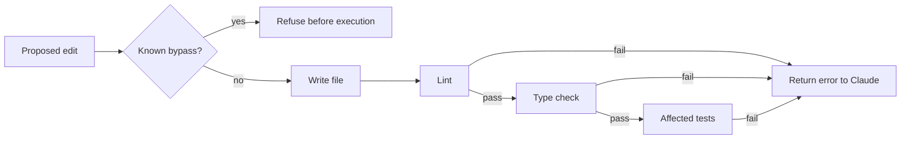

# BETON

[](https://github.com/NetBr3ak/beton/actions/workflows/tests.yml)
[](LICENSE)

[Po polsku](README.pl.md)

BETON is a Claude Code plugin that runs lint, type checks and affected tests after `Write`, `Edit` and `MultiEdit`. It sends failures back to Claude so the next change can address them. A separate guard rejects common shortcuts, such as `# noqa`, `@ts-ignore` and skipped tests, before the tool runs.

The post-edit hook does not undo a write or prevent that write from happening. Test discovery uses file names, not a dependency graph. Missing tools are skipped. BETON is a feedback loop, not a security sandbox or proof that a change is correct.



## Install

Requires Bash, Python 3.11 or later, Node.js and a Claude Code version with plugin support. Install the checkers used by your project separately. BETON does not download them.

```bash
claude plugin marketplace add https://github.com/NetBr3ak/beton
claude plugin install beton@beton
```

Restart Claude Code after installing. From a clone, use `claude plugin marketplace add "$PWD"` instead of the URL. See the [Claude Code plugin instructions](https://code.claude.com/docs/en/discover-plugins).

To uninstall from the default user scope:

```bash
claude plugin uninstall beton@beton
claude plugin marketplace remove beton
```

If you installed into a project or local scope, pass the same `--scope` to uninstall. Uninstalling does not remove BETON's counters and last-file state under `~/.claude/`. Remove any manually configured statusline separately. No install or uninstall command changes your project source files.

## Checks

| Language | Lint | Type check | Tests |
|---|---|---|---|
| Python | ruff, else flake8 | mypy, else pyright | pytest |
| TypeScript | eslint | tsc with a nearby tsconfig.json | bun test, else locally installed vitest |
| JavaScript | eslint | Not run | bun test, else locally installed vitest |
| Rust | cargo clippy at a Cargo.toml repository root | Included in clippy | cargo test when matching test files are found |
| Go | staticcheck | go vet | Not run |

For Python, start with `python3 -m pip install ruff mypy pytest`. For TypeScript, install and configure ESLint, TypeScript and your test runner in the project. An installed checker with invalid configuration reports a failure.

Tests are matched by `test_NAME.EXT`, `NAME_test.EXT`, `NAME.test.EXT` or `NAME.spec.EXT`. Editing a matching test file runs that file. Discovery stops at the nearest project marker or Git root. The post-edit hook runs tests only inside a Git working tree. It does not run the full suite for every edit, and it does not verify Bash writes.

## Guard and legitimate test removal

The guard checks new text for suppression comments and skip or focus markers. It also checks Bash commands that remove or move conventionally named test files. These are text and syntax checks, not a complete defense against an adversarial agent.

Python test removal has a narrow exception:

- A simple `rm source.py test_source.py` is allowed when the test directly imports and uses the removed source. Removing unrelated source does not qualify. Tests that also use retained source remain protected.
- To remove a Python test function, remove its directly imported source definition first. The guard compares source definitions with Git `HEAD`. Then remove the test through `Edit`, `Write` or `MultiEdit` in the same uncommitted change.
- Removing a test alone or renaming it without removing its source is rejected.

The exception supports top-level `from module import symbol` imports and Python test functions or methods named `test_*`. Relative imports, indirect fixtures, other languages and compound shell deletion commands are not resolved. Review these cases yourself before using the opt-out.

To disable only the guard for a Claude Code session:

```bash
BETON_BYPASS_GUARD=off claude
```

To disable both verification hooks, launch with `BETON_MODE=off claude`. Disabled hooks do not record decisions. A string containing a suppression marker can trigger a false positive in source code; document and fixture extensions are excluded.

## Configuration

| Environment variable | Default | Meaning |
|---|---|---|
| `BETON_MODE` | `strict` | `strict` or `off` |
| `BETON_BYPASS_GUARD` | `on` | `off` disables the pre-edit guard |
| `BETON_LINT_TIMEOUT` | `4` | Lint timeout in seconds |
| `BETON_TC_TIMEOUT` | `5` | Type-check timeout in seconds |
| `BETON_TEST_TIMEOUT` | `8` | Test timeout in seconds |
| `BETON_VERIFY_TIMEOUT` | `8` | Legacy fallback for the test timeout |
| `BETON_PAYLOAD_BUDGET` | `2400` | Error-text character budget before truncation markers |

Defaults come from `hooks/post-tool-verify.sh`. The outer Claude Code hook timeout also bounds the chain, so raising stage limits alone does not extend it. A nonzero checker status, including timeout, is a failure even without output.

Mode can also be set in `$XDG_CONFIG_HOME/beton/config.json`, or `~/.config/beton/config.json`, with `{"mode":"off"}`. A valid environment value takes precedence.

## Skills and utilities

`beton-swebench` asks Claude to localize a bug, reproduce it, fix it and validate the result. The prompt guides behavior; hooks do not prove that Claude followed these phases. `localize` and `repo-map` are optional subagents. `/beton` lists installed verifier tools.

```bash
bash bin/repo-map . --budget 1800
python3 bin/beton-session-stats --project "$PWD"
python3 bin/beton-stats summary
```

The session utility reports usage from local Claude Code logs, not a provider bill. Its cache-hit ratio is cache-read tokens divided by all input tokens.

`hooks/statusline.sh` renders the last check and daily counters. Counters reset at local midnight, not after a rolling day. Statuslines need manual configuration in Claude Code settings; the manifest's legacy `statusLine` field is ignored by current Claude Code. Do not overwrite an existing statusline. The [statusline documentation](https://code.claude.com/docs/en/statusline) explains how to compose a command using a stable path to your clone.

## Demo and evidence

[The Flask demo](examples/buggy-flask/README.md) contains an intentional expiry-boundary bug. It is not a benchmark. Its README explains how to add a failing test and fix it.

Run the offline checks from a fresh clone:

```bash
python3 -m venv .venv
. .venv/bin/activate
python3 -m pip install ruff mypy pytest pyyaml
bash scripts/check.sh
```

Node.js is required. ESLint and TypeScript enable additional checker tests. CI installs them and runs the same command. The runner returns a failure if any check fails. See [CONTRIBUTING.md](CONTRIBUTING.md) for the test layout.

The [eval scripts](evals/README.md) include synthetic bug scenarios and optional API experiments. No model-response snapshots or measured model-quality claims are published here. The offline dry run checks that the planted bugs fail their oracle tests; it does not measure model performance. API experiments require a separate SDK install and incur provider charges. CI makes no model API calls.

## Sources and license

The localization workflow draws on [Agentless (Xia et al., 2024)](https://arxiv.org/abs/2407.01489). Hook behavior follows [Anthropic's hook reference](https://code.claude.com/docs/en/hooks).

Code, synthetic scenarios and documentation are distributed under [MIT](LICENSE). No images, fonts, audio or external benchmark datasets are bundled. CI and license badges are rendered externally by GitHub and Shields.io.
