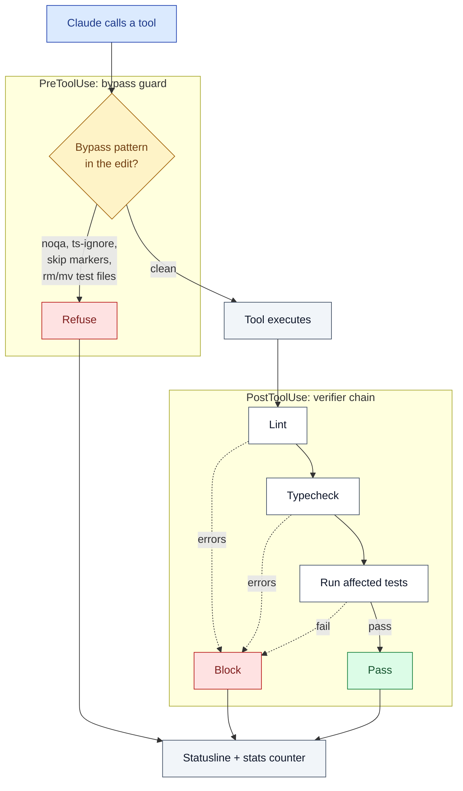
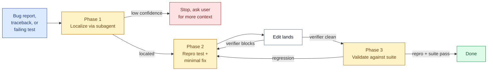

# BETON

[](https://github.com/NetBr3ak/beton/actions/workflows/tests.yml)
[](LICENSE)

Read this in Polish: [README.pl.md](README.pl.md)

BETON is a Claude Code plugin. It runs lint, typecheck, and the affected tests after every `Write`, `Edit`, or `MultiEdit`. If a check fails, BETON blocks the tool call and sends the error back to Claude.

Claude often reaches for a shortcut instead of a real fix: adding `# noqa`, `@ts-ignore`, `pytest.mark.skip`, or renaming a failing test. BETON blocks these shortcuts at the `PreToolUse` layer. The skill prompt and the hook layer enforce the same rule.

That is the whole product. No notation, no DSL.

## How an edit flows through BETON



BETON has two hook layers, and both enforce the same rule. `PreToolUse` refuses shortcuts before they land. `PostToolUse` runs the real checks after the edit. Every outcome (refusal, block, clean pass) updates the stats counter, and the statusline shows it.

## Install

```bash
claude plugin marketplace add https://github.com/NetBr3ak/beton
claude plugin install beton@beton
```

From a local clone:

```bash
claude plugin marketplace add /path/to/beton
claude plugin install beton@beton
```

## Verifier matrix

| Language        | Lint              | Typecheck       | Tests              |
|-----------------|-------------------|-----------------|--------------------|
| Python          | ruff or flake8    | mypy or pyright | pytest             |
| TypeScript / JS | eslint            | tsc             | bun test or vitest |
| Rust            | clippy            | clippy          | cargo test         |
| Go              | staticcheck       | go vet          |                    |

BETON skips a check if the matching tool is missing. It never blocks a file with an extension it does not know. If you do not have a tool installed, BETON stays silent on edits that need it.

```bash
pip install ruff mypy pytest
npm install -g eslint typescript
brew install universal-ctags  # optional, makes repo-map smarter
```

## Demo

`examples/buggy-flask/` is a small Flask app with one planted bug. Open it in Claude Code and ask:

> There's an off-by-one in `is_token_valid`. Add a regression test that catches it, then fix it.

You should see this happen: the localize subagent runs, Claude writes a new test, the verifier blocks on the failing test, Claude lands the fix, and the statusline flips from `BETON ✗1` to `BETON ✓`. Full walkthrough in [`examples/buggy-flask/README.md`](examples/buggy-flask/README.md).

## Who this is for

BETON helps you if:

- You use Claude Code for real code changes, not one-off questions.
- Your codebase already has ruff, mypy, eslint, or similar tools configured.
- Your test suite catches real problems, even some of the time.
- You have caught yourself, or an AI assistant, suppressing an error instead of fixing it.

BETON will not help you much if:

- You use Claude Code mostly for prototyping and throwaway scripts.
- Your project has no lint, type checking, or tests.
- You want quick conversational help, not engineered changes.

## Bypass guard

The `beton-swebench` skill tells Claude not to take shortcuts. The `PreToolUse` guard enforces that rule. It refuses these patterns before the edit lands:

- Suppression comments: `# noqa`, `# type: ignore`, `@ts-ignore`, `@ts-expect-error`, `eslint-disable`, `biome-ignore`, `prettier-ignore`, `# ruff: noqa`.
- Test-skip markers: `@pytest.mark.skip`, `@pytest.mark.xfail`, `@unittest.skip`, `it.skip`/`test.skip`/`describe.skip`, `.only` on test functions.
- Bash commands that `rm` or `mv` test files (`test_*.py`, `*_test.go`, `*.test.ts`, `*.spec.ts`).

Each refusal sends Claude a JSON block with the exact pattern that triggered it. If you genuinely need a suppression (for example, legacy code or a false-positive lint rule), turn the guard off for that edit:

```bash
BETON_BYPASS_GUARD=off
```

The guard never allows a bypass silently. It logs the decision in `~/.claude/.beton-stats.json` either way.

### What this guard is not

The guard is a list of known bypass patterns. It is not an airtight gate. A determined model can still route around it: use `# pylint: disable` instead of `# noqa`, write `assert False` instead of `@pytest.mark.skip`, or replace a real test body with `pass`. The guard cannot make bypassing impossible. It raises the cost of the obvious bypass moves above the cost of just fixing the error, and it makes the attempts visible in your stats. Treat it as a floor on AI-driven code edits, not a ceiling.

## Tuning

| Var                      | Default | Purpose                                   |
|--------------------------|---------|--------------------------------------------|
| `BETON_LINT_TIMEOUT`     | 4       | Lint step, seconds                        |
| `BETON_TC_TIMEOUT`       | 5       | Typecheck step                            |
| `BETON_TEST_TIMEOUT`     | 8       | Tests step (falls back to VERIFY_TIMEOUT) |
| `BETON_VERIFY_TIMEOUT`   | 8       | Legacy alias for the tests step           |
| `BETON_PAYLOAD_BUDGET`   | 2400    | Max bytes of error sent back to Claude    |
| `BETON_BYPASS_GUARD`     | `on`    | Set `off` to disable PreToolUse refusals  |
| `BETON_MODE`             | strict  | `strict` (enforce) or `off` (disable both hooks) |

`BETON_MODE` also reads from a config file: `$XDG_CONFIG_HOME/beton/config.json` (or `~/.config/beton/config.json`), a JSON file with a `"mode"` key. The environment variable wins over the config file.

## Skill: beton-swebench

This skill loads automatically on bug fixes, tracebacks, and failing tests. It enforces three phases, in order. Claude cannot skip ahead.



Source: Agentless (Xia et al., 2024).

## Subagents

| Agent       | Use                                                                |
|-------------|--------------------------------------------------------------------|
| `repo-map`  | Token-budgeted symbol index. Spawn before editing unfamiliar code. |
| `localize`  | Ranked file/function candidates from a stack trace or issue.       |

Both agents default to the `haiku` model family alias. This alias always points at the latest Haiku model, rather than one fixed version. To use a different model, edit the `model:` field at the top of `agents/localize.md` or `agents/repo-map.md`.

## Command

`/beton` reports which verifier tools are installed.

## Statusline

When the plugin is active, the statusline shows the last verifier outcome plus a rolling 24-hour count:

```
BETON ✓
BETON ✓ · 4 blocks 1 bypass refused
BETON ✗2 · 4 blocks 1 bypass refused
```

The badge stays silent when nothing has happened today. It shows nothing at all if the plugin has not run yet.

## Evals

Evals measure the skill in two stages, so CI does not need API keys.

```bash
# Stage 1: call the API and snapshot per-model responses (run once, commit the result)
python3 evals/llm_run.py

# Stage 2: analyze the snapshot offline; runs in CI
python3 evals/measure.py
python3 evals/measure.py --fail-below 0.9 --fail-bypass-below 0.8
```

The prompt set lives in `evals/prompts/en.json`. It has 25 bug prompts across off-by-one, null-deref, async, config, type-coerce, regex, encoding, and a few generic categories, plus 5 bypass prompts (noqa, rename, type-ignore, skip, delete-test). The eval compares the skill against a terse-instructions control, not against a no-system-prompt baseline. This isolates the skill's real contribution from the effect of just being terse.

Each snapshot embeds the SHA256 hash of `skills/beton-swebench/SKILL.md`. This ties results to the exact skill version that produced them. Running `evals/llm_run.py` again produces a fresh snapshot under `evals/snapshots/`.

`evals/swebench_mini.py` is an end-to-end resolve-rate test. Each scenario in `evals/swebench_mini_scenarios.json` ships a starter file with a planted bug, plus an oracle test that fails on the buggy code. The harness builds the scenario, asks the model for full-file replacements, and runs pytest. These scenarios are small on purpose (1-3 files) and check that the pipeline works. A real resolve-rate measurement needs full SWE-bench-Verified at full repo scale. See `evals/README.md` for details.

## Utilities

```bash
bash bin/repo-map . --budget 1800
python3 bin/beton-session-stats --project /path/to/project
bin/beton-stats summary
```

## Tests

```bash
for t in tests/test-*.sh; do bash "$t"; done
```

## FAQ

**Will this slow me down?**

Each verifier stage has its own timeout: 4 seconds for lint, 5 for typecheck, 8 for tests, by default. A clean edit in a small project finishes in a couple of seconds. Raise the timeouts in the Tuning section if you need more room.

**What if I really need to suppress a lint rule?**

Set `BETON_BYPASS_GUARD=off` for that edit, make the change, then turn the guard back on. The decision still lands in the stats file, so you can see it later if you forget you made it.

**Why not just use pre-commit hooks?**

A pre-commit hook fires on `git commit`. By then, the AI may have already made a long chain of edits, and some of them may have silently broken things. BETON fires after every single `Write`/`Edit`, closer to where bypass behavior actually happens.

**Does this work outside Claude Code?**

The verifier scripts (`bin/lint-file`, `bin/typecheck-file`, `bin/run-affected-tests`) work standalone. You can wire them into any other hook system. The `PreToolUse` guard only fires inside Claude Code, through the plugin hook system, because it depends on the tool event JSON format Claude Code sends.

**The eval says Haiku doesn't refuse bypasses any better with the skill than without it. Does the skill work?**

For Haiku, the skill's main contribution is Phase 1 adherence: it goes from 0% to 100%. The skill does not beat plain terse instructions at stopping Haiku's shortcut behavior. If bypass refusal matters in your workflow, set the localize subagent to use Sonnet by editing the `model:` field in `agents/localize.md`.

**Can I use this with multiple Claude Code sessions in parallel?**

Yes. The stats file uses `fcntl.flock` for atomic increments. It has been stress-tested at 100-way parallel writes with zero lost updates.

**Does the bypass guard catch every possible bypass?**

No. It is a list of common patterns, not a complete defense. Read "What this guard is not" under Bypass guard above for the full picture.

## Acknowledgments

The bug-fix pipeline is based on Agentless (Xia et al., 2024), which first described the localize, reproduce, fix, and validate sequence that `beton-swebench` uses.

The plugin plumbing follows Anthropic's Claude Code plugin specification.

## License

MIT
