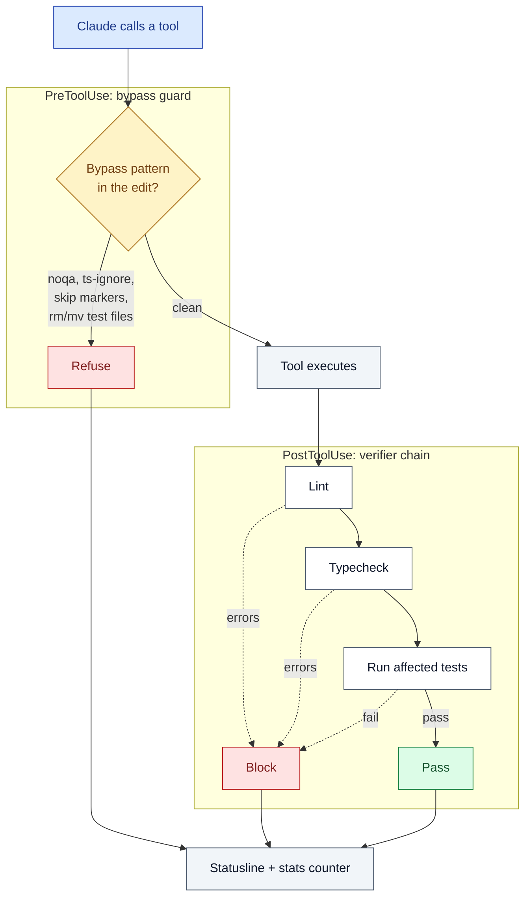
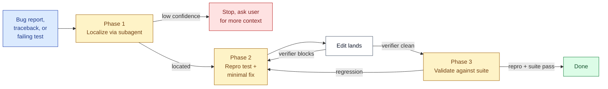

# BETON

[](https://github.com/NetBr3ak/beton/actions/workflows/tests.yml)
[](LICENSE)

Read this in English: [README.md](README.md)

BETON to plugin do Claude Code. Po każdym `Write`, `Edit` lub `MultiEdit` uruchamia lint, typecheck i testy dla zmienionego kodu. Gdy sprawdzenie się nie powiedzie, BETON blokuje wywołanie narzędzia i odsyła błąd do Claude.

Claude często sięga po skrót zamiast prawdziwej naprawy: dodaje `# noqa`, `@ts-ignore`, `pytest.mark.skip`, albo zmienia nazwę niedziałającego testu. BETON blokuje takie skróty na poziomie `PreToolUse`. Prompt skilla i warstwa hooków wymuszają tę samą zasadę.

To cały produkt. Bez notacji, bez własnego języka (DSL).

## Jak edycja przechodzi przez BETON



BETON ma dwie warstwy hooków, obie wymuszają tę samą zasadę. `PreToolUse` odmawia skrótów, zanim trafią do kodu. `PostToolUse` uruchamia właściwe sprawdzenia po edycji. Każdy wynik (odmowa, blokada, czysty przebieg) aktualizuje licznik statystyk, a pasek statusu go pokazuje.

## Instalacja

```bash
claude plugin marketplace add https://github.com/NetBr3ak/beton
claude plugin install beton@beton
```

Z lokalnego klonu repozytorium:

```bash
claude plugin marketplace add /path/to/beton
claude plugin install beton@beton
```

## Macierz narzędzi sprawdzających

| Język            | Lint              | Typecheck       | Testy              |
|-----------------|-------------------|-----------------|--------------------|
| Python          | ruff lub flake8   | mypy lub pyright | pytest             |
| TypeScript / JS | eslint            | tsc             | bun test lub vitest |
| Rust            | clippy            | clippy          | cargo test         |
| Go              | staticcheck       | go vet          |                    |

Gdy brakuje danego narzędzia, BETON pomija ten krok. Nigdy nie blokuje pliku o nieznanym rozszerzeniu. Jeśli nie masz zainstalowanego narzędzia, BETON milczy przy edycjach, które go wymagają.

```bash
pip install ruff mypy pytest
npm install -g eslint typescript
brew install universal-ctags  # opcjonalnie, poprawia działanie repo-map
```

## Demo

`examples/buggy-flask/` to mała aplikacja Flask z jednym zaplanowanym błędem. Otwórz ten katalog w Claude Code i zapytaj:

> There's an off-by-one in `is_token_valid`. Add a regression test that catches it, then fix it.

Powinieneś zobaczyć: subagent localize analizuje kod, Claude pisze nowy test, weryfikator blokuje na niedziałającym teście, Claude wprowadza poprawkę, a pasek statusu zmienia się z `BETON ✗1` na `BETON ✓`. Pełny opis w [`examples/buggy-flask/README.md`](examples/buggy-flask/README.md) (po angielsku).

## Dla kogo jest BETON

BETON pomoże ci, jeśli:

- Używasz Claude Code do realnych zmian w kodzie, nie tylko do pytań.
- Twój projekt ma już skonfigurowane ruff, mypy, eslint lub podobne narzędzia.
- Twoje testy łapią prawdziwe błędy, choćby czasami.
- Złapałeś siebie albo asystenta AI na tłumieniu błędu zamiast jego naprawy.

BETON niewiele ci da, jeśli:

- Używasz Claude Code głównie do prototypów i jednorazowych skryptów.
- Twój projekt nie ma lintera, sprawdzania typów ani testów.
- Chcesz szybkiej rozmowy, a nie kontrolowanych zmian w kodzie.

## Ochrona przed obchodzeniem sprawdzeń (bypass guard)

Skill `beton-swebench` mówi Claude, żeby nie szukał skrótów. Strażnik `PreToolUse` wymusza tę zasadę. Odmawia tych wzorców, zanim edycja trafi do kodu:

- Komentarze tłumiące błędy: `# noqa`, `# type: ignore`, `@ts-ignore`, `@ts-expect-error`, `eslint-disable`, `biome-ignore`, `prettier-ignore`, `# ruff: noqa`.
- Znaczniki pomijania testów: `@pytest.mark.skip`, `@pytest.mark.xfail`, `@unittest.skip`, `it.skip`/`test.skip`/`describe.skip`, `.only` na funkcjach testowych.
- Polecenia Bash, które robią `rm` lub `mv` na plikach testowych (`test_*.py`, `*_test.go`, `*.test.ts`, `*.spec.ts`).

Każda odmowa wysyła do Claude blok JSON z dokładnym wzorcem, który ją wywołał. Jeśli naprawdę potrzebujesz tłumienia błędu (na przykład w starym kodzie albo przy fałszywym alarmie lintera), wyłącz strażnika dla tej edycji:

```bash
BETON_BYPASS_GUARD=off
```

Strażnik nigdy nie przepuszcza obejścia po cichu. Każdą decyzję zapisuje w `~/.claude/.beton-stats.json`.

### Czym ten strażnik nie jest

Strażnik to lista znanych wzorców obchodzenia sprawdzeń. To nie jest szczelna brama. Uparty model wciąż może ją obejść: użyć `# pylint: disable` zamiast `# noqa`, napisać `assert False` zamiast `@pytest.mark.skip`, albo zastąpić treść testu samym `pass`. Strażnik nie może uniemożliwić obchodzenia sprawdzeń. Podnosi koszt oczywistych obejść ponad koszt zwykłej naprawy błędu i pokazuje próby obejścia w statystykach. Traktuj go jako minimum bezpieczeństwa dla edycji robionych przez AI, nie jako pełną gwarancję.

## Ustawienia

| Zmienna                  | Domyślnie | Znaczenie                                   |
|--------------------------|---------|--------------------------------------------|
| `BETON_LINT_TIMEOUT`     | 4       | Krok lint, w sekundach                     |
| `BETON_TC_TIMEOUT`       | 5       | Krok typecheck                             |
| `BETON_TEST_TIMEOUT`     | 8       | Krok testów (domyślnie wraca do VERIFY_TIMEOUT) |
| `BETON_VERIFY_TIMEOUT`   | 8       | Starszy alias dla kroku testów             |
| `BETON_PAYLOAD_BUDGET`   | 2400    | Maksymalna liczba bajtów błędu wysyłanych do Claude |
| `BETON_BYPASS_GUARD`     | `on`    | Ustaw `off`, żeby wyłączyć odmowy PreToolUse |
| `BETON_MODE`             | strict  | `strict` (wymuszanie) albo `off` (wyłącza oba hooki) |

`BETON_MODE` odczytuje też plik konfiguracyjny: `$XDG_CONFIG_HOME/beton/config.json` (albo `~/.config/beton/config.json`), plik JSON z kluczem `"mode"`. Zmienna środowiskowa ma pierwszeństwo przed plikiem konfiguracyjnym.

## Skill: beton-swebench

Ten skill ładuje się sam przy naprawach błędów, tracebackach i niedziałających testach. Wymusza trzy fazy, w kolejności. Claude nie może ich pominąć.



Źródło: Agentless (Xia et al., 2024).

## Subagenci

| Agent       | Zastosowanie                                                       |
|-------------|--------------------------------------------------------------------|
| `repo-map`  | Indeks symboli z limitem tokenów. Uruchom przed edycją nieznanego kodu. |
| `localize`  | Ranking plików i funkcji na podstawie tracebacku albo zgłoszenia.  |

Oba agenty domyślnie używają aliasu modelu `haiku`. Ten alias zawsze wskazuje na najnowszy model Haiku, a nie na jedną ustaloną wersję. Aby użyć innego modelu, zmień pole `model:` na górze pliku `agents/localize.md` albo `agents/repo-map.md`.

## Komenda

`/beton` pokazuje, które narzędzia sprawdzające są zainstalowane.

## Pasek statusu

Gdy plugin jest aktywny, pasek statusu pokazuje ostatni wynik weryfikatora oraz licznik z ostatnich 24 godzin:

```
BETON ✓
BETON ✓ · 4 blocks 1 bypass refused
BETON ✗2 · 4 blocks 1 bypass refused
```

Odznaka milczy, gdy danego dnia nic się nie wydarzyło. Nic się nie pokazuje, jeśli plugin jeszcze nie zadziałał.

## Evals (testy jakości skilla)

Pomiar jakości skilla odbywa się w dwóch etapach, żeby CI nie potrzebowało kluczy API.

```bash
# Etap 1: wywołanie API i zapis odpowiedzi modeli (uruchamiane raz, wynik trafia do repozytorium)
python3 evals/llm_run.py

# Etap 2: analiza zapisanych danych bez połączenia z API; uruchamiane w CI
python3 evals/measure.py
python3 evals/measure.py --fail-below 0.9 --fail-bypass-below 0.8
```

Zestaw promptów jest w `evals/prompts/en.json`. Zawiera 25 promptów z błędami: off-by-one, null-deref, async, config, type-coerce, regex, encoding i kilka ogólnych kategorii, plus 5 promptów sprawdzających obchodzenie sprawdzeń (noqa, zmiana nazwy, type-ignore, skip, usunięcie testu). Test porównuje skill z wariantem kontrolnym, który dostaje tylko krótką instrukcję, a nie z wariantem bez żadnego promptu systemowego. Dzięki temu widać wkład samego skilla, oddzielony od samej zwięzłości instrukcji.

Każdy zapis (snapshot) zawiera hash SHA256 pliku `skills/beton-swebench/SKILL.md`. Dzięki temu wynik jest powiązany z dokładną wersją skilla, która go wygenerowała. Ponowne uruchomienie `evals/llm_run.py` tworzy nowy zapis w `evals/snapshots/`.

`evals/swebench_mini.py` to test end-to-end mierzący skuteczność napraw. Każdy scenariusz w `evals/swebench_mini_scenarios.json` zawiera plik startowy z zaplanowanym błędem oraz test wzorcowy, który nie przechodzi na wadliwym kodzie. Uruchomienie buduje scenariusz, prosi model o pełną nową treść pliku i uruchamia pytest. Scenariusze są celowo małe (1-3 pliki) i sprawdzają, czy cały mechanizm działa. Prawdziwy pomiar skuteczności napraw wymaga pełnego SWE-bench-Verified na skalę całych repozytoriów. Szczegóły w `evals/README.md` (po angielsku).

## Narzędzia pomocnicze

```bash
bash bin/repo-map . --budget 1800
python3 bin/beton-session-stats --project /path/to/project
bin/beton-stats summary
```

## Testy

```bash
for t in tests/test-*.sh; do bash "$t"; done
```

## Najczęstsze pytania

**Czy to mnie spowolni?**

Każdy krok weryfikatora ma własny limit czasu: domyślnie 4 sekundy dla lintu, 5 dla typecheck, 8 dla testów. Czysta edycja w małym projekcie kończy się w kilka sekund. Limity możesz zwiększyć w sekcji Ustawienia.

**Co, jeśli naprawdę muszę wyłączyć regułę lintera?**

Ustaw `BETON_BYPASS_GUARD=off` na czas tej edycji, wprowadź zmianę, potem włącz strażnika z powrotem. Decyzja i tak trafia do pliku statystyk, więc zobaczysz ją później, nawet jeśli zapomnisz.

**Czemu nie użyć zwykłych hooków pre-commit?**

Hook pre-commit uruchamia się przy `git commit`. Do tego momentu AI mogło już wykonać długi ciąg edycji, z których część mogła po cichu coś zepsuć. BETON uruchamia się po każdym pojedynczym `Write`/`Edit`, bliżej momentu, w którym faktycznie dochodzi do obchodzenia sprawdzeń.

**Czy to działa poza Claude Code?**

Skrypty weryfikujące (`bin/lint-file`, `bin/typecheck-file`, `bin/run-affected-tests`) działają samodzielnie. Możesz je podłączyć do innego systemu hooków. Strażnik `PreToolUse` działa tylko wewnątrz Claude Code, przez system hooków pluginu, bo zależy od formatu JSON zdarzeń narzędzi, jaki wysyła Claude Code.

**Wyniki testów pokazują, że Haiku nie odmawia obchodzenia sprawdzeń lepiej ze skillem niż bez niego. Czy skill w ogóle działa?**

Dla modelu Haiku głównym wkładem skilla jest trzymanie się Fazy 1: skuteczność rośnie z 0% do 100%. Skill nie pokonuje zwykłej krótkiej instrukcji w powstrzymywaniu Haiku przed szukaniem skrótów. Jeśli odmowa obchodzenia sprawdzeń ma dla ciebie znaczenie, ustaw subagenta localize na model Sonnet, zmieniając pole `model:` w `agents/localize.md`.

**Czy mogę używać tego w kilku sesjach Claude Code równolegle?**

Tak. Plik statystyk używa `fcntl.flock` do atomowego zwiększania liczników. Przetestowano ze 100 równoległymi zapisami, bez utraty żadnej aktualizacji.

**Czy strażnik obchodzenia sprawdzeń łapie każdy możliwy sposób obejścia?**

Nie. To lista znanych wzorców, nie pełna ochrona. Pełny opis w sekcji "Czym ten strażnik nie jest" powyżej.

## Podziękowania

Mechanizm naprawy błędów opiera się na pracy Agentless (Xia i in., 2024), która jako pierwsza opisała sekwencję: zlokalizuj, odtwórz błąd, napraw, zwaliduj, używaną przez `beton-swebench`.

Struktura pluginu jest zgodna ze specyfikacją pluginów Claude Code od Anthropic.

## Licencja

MIT
