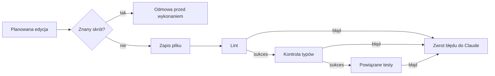

# BETON

[](https://github.com/NetBr3ak/beton/actions/workflows/tests.yml)
[](LICENSE)

[English](README.md)

BETON to plugin do Claude Code. Po `Write`, `Edit` i `MultiEdit` uruchamia lint, kontrolę typów i powiązane testy. Zwraca błędy do Claude, aby kolejna zmiana mogła je naprawić. Osobna kontrola odrzuca skróty, takie jak `# noqa`, `@ts-ignore` i pomijanie testów, przed wykonaniem narzędzia.

Kontrola po edycji nie cofa zapisu ani mu nie zapobiega. Testy dobiera według nazw plików, nie grafu zależności. Pomija brakujące narzędzia. BETON przekazuje wyniki kontroli, ale nie jest izolacją bezpieczeństwa ani dowodem poprawności zmiany.



## Instalacja

Wymagane są Bash, Python od wersji 3.11, Node.js i Claude Code z obsługą pluginów. Narzędzia sprawdzające projekt instalujesz osobno. BETON ich nie pobiera.

```bash
claude plugin marketplace add https://github.com/NetBr3ak/beton
claude plugin install beton@beton
```

Po instalacji uruchom Claude Code ponownie. Z lokalnego klonu użyj `claude plugin marketplace add "$PWD"` zamiast adresu URL. Zobacz [instrukcję pluginów Claude Code](https://code.claude.com/docs/en/discover-plugins).

Odinstalowanie z domyślnego zakresu użytkownika:

```bash
claude plugin uninstall beton@beton
claude plugin marketplace remove beton
```

Jeśli instalacja miała zakres projektu lub lokalny, podaj ten sam `--scope` przy odinstalowaniu. Liczniki i stan ostatniego pliku w `~/.claude/` pozostają. Osobno usuń ręczną konfigurację paska stanu. Te polecenia nie zmieniają źródeł projektu.

## Kontrole

| Język | Lint | Kontrola typów | Testy |
|---|---|---|---|
| Python | ruff, w drugiej kolejności flake8 | mypy, w drugiej kolejności pyright | pytest |
| TypeScript | eslint | tsc z pobliskim tsconfig.json | bun test, w drugiej kolejności lokalny vitest |
| JavaScript | eslint | Brak | bun test, w drugiej kolejności lokalny vitest |
| Rust | cargo clippy w głównym katalogu repo z Cargo.toml | W clippy | cargo test, gdy znajdzie pasujące pliki testów |
| Go | staticcheck | go vet | Brak |

Dla Pythona zainstaluj `python3 -m pip install ruff mypy pytest`. Dla TypeScript zainstaluj i skonfiguruj ESLint, TypeScript oraz narzędzie testujące w projekcie. Błąd konfiguracji zainstalowanego narzędzia jest błędem kontroli.

Nazwy testów muszą pasować do `test_NAME.EXT`, `NAME_test.EXT`, `NAME.test.EXT` lub `NAME.spec.EXT`. Edycja takiego pliku uruchamia ten plik. Wyszukiwanie kończy się przy najbliższym znaczniku projektu lub katalogu Git. Hook po edycji uruchamia testy tylko w drzewie roboczym Git. Nie uruchamia całego zestawu po każdej edycji i nie sprawdza zapisów przez Bash.

## Ochrona testów i usuwanie kodu

Kontrola szuka w nowym tekście znaczników wyciszania błędów, pomijania testów i wyboru pojedynczego testu. Sprawdza też polecenia Bash usuwające lub przenoszące pliki o nazwach testów. Analizuje tekst i składnię. Nie zapewnia pełnej ochrony przed agentem, który celowo omija reguły.

Usuwanie testów Pythona ma wąski wyjątek:

- Proste `rm source.py test_source.py` jest dozwolone, gdy test bezpośrednio importuje i używa usuwanego źródła. Usunięcie niepowiązanego źródła nie wystarcza. Testy używające również zachowanego źródła pozostają chronione.
- Aby usunąć funkcję testową, najpierw usuń bezpośrednio importowaną definicję źródłową. Kontrola porównuje definicje z Git `HEAD`. Potem usuń test przez `Edit`, `Write` lub `MultiEdit` w tej samej niezatwierdzonej zmianie.
- Usunięcie samego testu lub zmiana jego nazwy bez usunięcia źródła są odrzucane.

Wyjątek obsługuje importy `from module import symbol` na poziomie modułu i funkcje lub metody Pythona o nazwach `test_*`. Nie rozwiązuje importów względnych, pośrednich fixtures, innych języków ani złożonych poleceń usuwania. Takie przypadki sprawdź sam przed wyłączeniem ochrony.

Wyłączenie samej kontroli skrótów dla sesji Claude Code:

```bash
BETON_BYPASS_GUARD=off claude
```

`BETON_MODE=off claude` wyłącza oba hooki sprawdzające. Wyłączone hooki nie zapisują decyzji. Znacznik wyciszania błędu wewnątrz tekstu źródłowego może wywołać fałszywy alarm. Dokumenty i pliki danych mają wyjątek według rozszerzenia.

## Konfiguracja

| Zmienna środowiskowa | Domyślnie | Znaczenie |
|---|---|---|
| `BETON_MODE` | `strict` | `strict` lub `off` |
| `BETON_BYPASS_GUARD` | `on` | `off` wyłącza kontrolę przed edycją |
| `BETON_LINT_TIMEOUT` | `4` | Limit lint w sekundach |
| `BETON_TC_TIMEOUT` | `5` | Limit kontroli typów w sekundach |
| `BETON_TEST_TIMEOUT` | `8` | Limit testów w sekundach |
| `BETON_VERIFY_TIMEOUT` | `8` | Starszy alias limitu testów |
| `BETON_PAYLOAD_BUDGET` | `2400` | Limit znaków błędu przed dodaniem znaczników skrótu |

Wartości pochodzą z `hooks/post-tool-verify.sh`. Łańcuch ogranicza też zewnętrzny limit hooka Claude Code. Samo zwiększenie limitów etapów go nie wydłuża. Każdy niezerowy kod narzędzia jest błędem, również przekroczenie czasu bez komunikatu.

Tryb można zapisać w `$XDG_CONFIG_HOME/beton/config.json` lub `~/.config/beton/config.json` jako `{"mode":"off"}`. Poprawna wartość zmiennej środowiskowej ma pierwszeństwo.

## Umiejętności i narzędzia

`beton-swebench` instruuje Claude, aby zlokalizował błąd, odtworzył go, naprawił i sprawdził wynik. Hooki nie dowodzą wykonania tych faz. `localize` i `repo-map` to opcjonalni podagenci. `/beton` pokazuje dostępne narzędzia kontroli.

```bash
bash bin/repo-map . --budget 1800
python3 bin/beton-session-stats --project "$PWD"
python3 bin/beton-stats summary
```

Narzędzie sesji odczytuje zużycie z lokalnych logów Claude Code. Nie jest rachunkiem dostawcy. Udział odczytu pamięci podręcznej dzieli liczbę tokenów z tego odczytu przez wszystkie tokeny wejściowe.

`hooks/statusline.sh` pokazuje ostatni wynik i liczniki dzienne. Liczniki zerują się o lokalnej północy. Pasek stanu trzeba skonfigurować ręcznie w ustawieniach Claude Code. Obecne Claude Code ignoruje starsze pole `statusLine` w manifeście. Nie nadpisuj istniejącego paska. [Dokumentacja paska stanu](https://code.claude.com/docs/en/statusline) opisuje polecenie ze stałą ścieżką do klonu.

## Demo i dowody

[Demo Flask](examples/buggy-flask/README.md) zawiera celowy błąd granicy ważności tokenu. Nie jest benchmarkiem. Instrukcja pokazuje dodanie testu odtwarzającego błąd i jego naprawę.

Kontrole bez API z nowego klonu:

```bash
python3 -m venv .venv
. .venv/bin/activate
python3 -m pip install ruff mypy pytest pyyaml
bash scripts/check.sh
```

Wymagany jest Node.js. ESLint i TypeScript włączają dodatkowe testy narzędzi. CI instaluje je i wykonuje to samo polecenie. Skrypt kończy się błędem, gdy dowolna kontrola nie przejdzie. Układ testów opisuje [CONTRIBUTING.md](CONTRIBUTING.md).

[Skrypty pomiarowe](evals/README.md) obejmują syntetyczne błędy i opcjonalne eksperymenty API. Repo nie publikuje odpowiedzi modeli ani wyników ich jakości. Próba bez API sprawdza, czy celowe błędy oblewają testy wzorcowe. Nie mierzy skuteczności modeli. Eksperymenty API wymagają osobnej instalacji SDK i powodują opłaty dostawcy. CI nie wywołuje API modeli.

## Źródła i licencja

Przebieg lokalizacji opiera się na [Agentless (Xia i inni, 2024)](https://arxiv.org/abs/2407.01489). Hooki korzystają z [dokumentacji Anthropic](https://code.claude.com/docs/en/hooks).

Kod, syntetyczne scenariusze i dokumentacja mają [licencję MIT](LICENSE). Repo nie zawiera obrazów, fontów, dźwięku ani zewnętrznych zbiorów benchmarkowych. Odznaki CI i licencji renderują GitHub i Shields.io.
